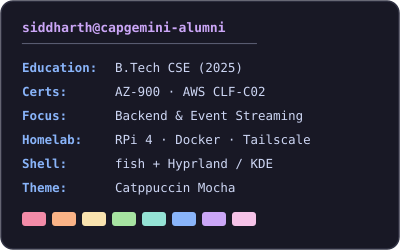
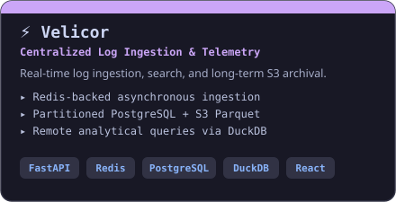
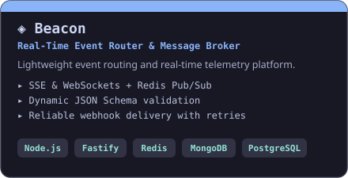
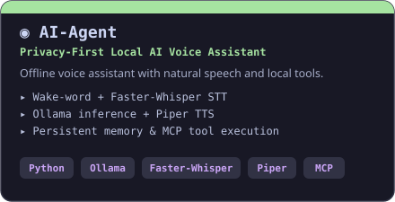
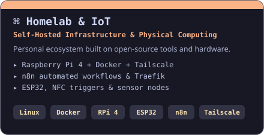

<!--
  GitHub Profile README
  Theme: Catppuccin Mocha (Base: #1e1e2e, Mantle: #181825, Surface0: #313244, Mauve: #cba6f7)
  Username: siddharthjain25
-->

  <!-- Custom Catppuccin Mocha Terminal Hero Banner -->
  

    

  <!-- Navigation / Social Action Bar -->
  
  
  
  

 

<!-- 01 / ABOUT ME -->

<table width="100%">
  <tr>
    <td width="55%" valign="top">
       
      

        <b>Backend & Integration Software Engineer</b> focused on building resilient distributed systems, event-driven pipelines, and self-hosted cloud infrastructure.
      

      <ul>
        <li><b>Enterprise Systems:</b> Software Engineer at <b>Capgemini</b>, engineering financial-services backend integrations and high-throughput microservices.</li>
        <li><b>Performance Engineering:</b> Delivered <b>3× higher Kafka throughput</b> and cut batch processing times by <b>30–40 minutes</b> in production.</li>
        <li><b>Homelab & Edge AI:</b> Operating a personal Raspberry Pi & Linux infrastructure stack running local-first AI voice agents and automated workflows.</li>
      </ul>
      <blockquote>
        <i>"Understanding how systems work beneath the surface, building from first principles, and making infrastructure reliable."</i>
      </blockquote>
    </td>
    <td width="45%" valign="top">
      
    </td>
  </tr>
</table>

 

<!-- 02 / TECH STACK -->

<table width="100%">
  <tr>
    <td width="25%" valign="top" align="center">
      <b><code>LANGUAGES</code></b>  
       
       
       
       
       
      
    </td>
    <td width="25%" valign="top" align="center">
      <b><code>BACKEND & WEB</code></b>  
       
       
       
       
       
      
    </td>
    <td width="25%" valign="top" align="center">
      <b><code>DATA & STREAMING</code></b>  
       
       
       
       
      
    </td>
    <td width="25%" valign="top" align="center">
      <b><code>CLOUD & INFRA</code></b>  
       
       
       
       
       
       
      
    </td>
  </tr>
</table>

 

<!-- 03 / FEATURED PROJECTS -->

<table width="100%">
  <tr>
    <td width="50%" valign="top">
      
    </td>
    <td width="50%" valign="top">
      
    </td>
  </tr>
  <tr>
    <td width="50%" valign="top">
      
    </td>
    <td width="50%" valign="top">
      
    </td>
  </tr>
</table>

 

<!-- 04 / GITHUB ANALYTICS -->

  <table>
    <tr>
      <td>
        
      </td>
      <td>
        
      </td>
    </tr>
  </table>

  

   

  

 

<!-- FOOTER -->

  
  
  

    
  

